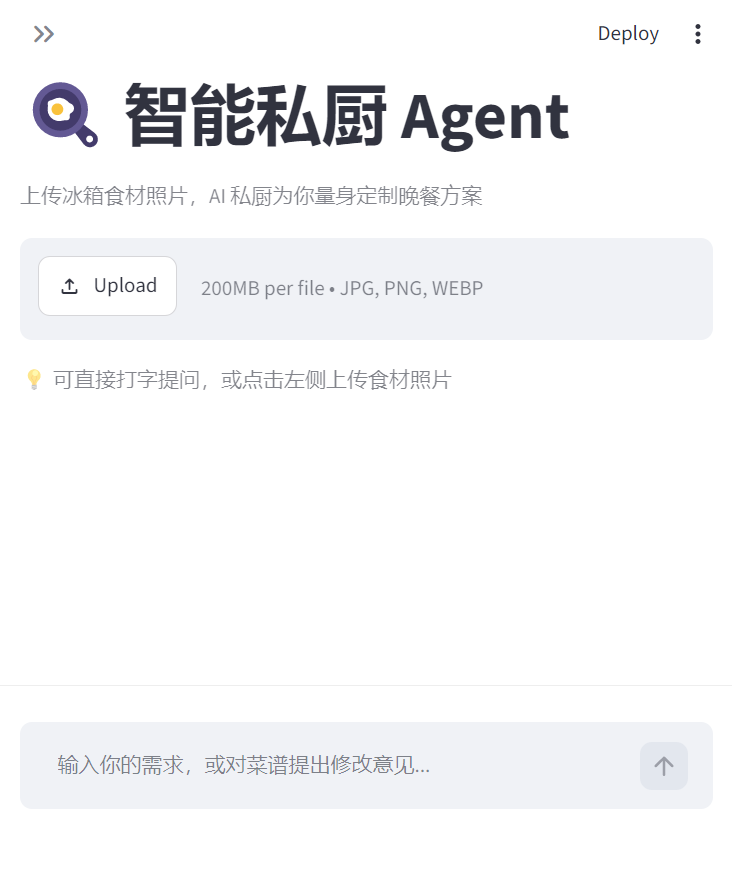
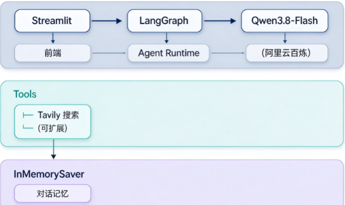

# 🍳 智能私厨 Agent

> 基于 LangChain + LangGraph + Qwen 多模态大模型的私人厨师助手。
> 上传冰箱食材照片，AI 自动识别食材、搜索真实菜谱、规划营养均衡的晚餐方案。

---

## ✨ 核心功能

- 📷 **多模态识图**：上传冰箱照片，模型自动识别食材清单
- 🔍 **真实菜谱检索**：通过 Tavily 联网搜索「下厨房」「豆果美食」的真实做法
- 🧠 **多轮对话记忆**：基于 LangGraph Checkpointer，支持基于菜谱继续追问和修改
- 🎨 **流式输出**：前端逐字打印
- 💬 **智能降级**：搜索工具不可用时，自动切换为模型知识直接推荐

---

## 🏗️ 系统架构

